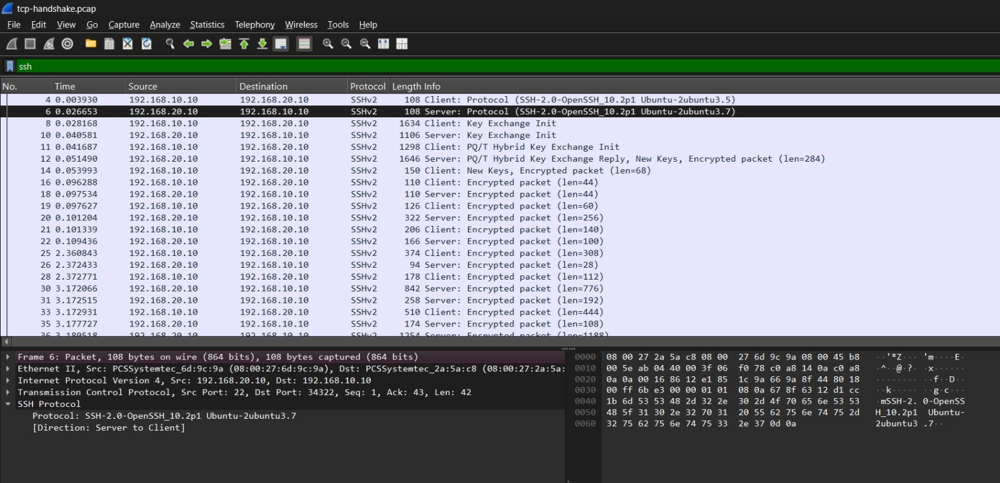

# SSH Protocol Analysis

## 1. Objective

The objective of this analysis is to inspect SSH (Secure Shell) traffic using Wireshark and understand how SSH establishes a secure session over TCP.

This analysis uses the existing `tcp-handshake.pcap` capture collected from a virtualized Linux network lab. It focuses on SSH version identification, key-exchange messages, and encrypted communication.

## 2. Lab Environment

| Component | Details |
|---|---|
| Client-A | `192.168.10.10` |
| Client-B | `192.168.20.10` |
| Transport protocol | TCP |
| Application protocol | SSHv2 |
| Server port | `22` |
| Capture tool | tcpdump |
| Analysis tool | Wireshark |

Client-A initiated an SSH connection to Client-B through the Linux router.

## 3. Capture and Filtering

The packet capture was collected on Client-A using:

```bash
sudo tcpdump -ni enp0s3 -w /tmp/tcp-handshake.pcap 'tcp port 22'
```

The following Wireshark display filter was used to isolate SSH packets:

```text
ssh
```

The capture contains the TCP connection establishment followed by SSH protocol negotiation and encrypted traffic.

## 4. Packet Analysis

### 4.1 SSH Version Identification

Packets 4 and 6 show the SSH identification strings exchanged by the client and server.

The captured versions include:

- Client: `SSH-2.0-OpenSSH_10.2p1 Ubuntu-2ubuntu3.5`
- Server: `SSH-2.0-OpenSSH_10.2p1 Ubuntu-2ubuntu3.7`

These identification strings indicate that both endpoints are using SSH protocol version 2 and identify their OpenSSH implementations.

### 4.2 Key-Exchange Initialization

Packets 8 and 10 show the client's and server's `Key Exchange Init` messages.

During this stage, the endpoints advertise supported cryptographic algorithms and parameters so they can negotiate how the SSH session will be protected.

Packet 11 shows a client hybrid key-exchange initialization, while packet 12 shows the corresponding server reply, followed by new keys and an encrypted packet.

### 4.3 Encrypted Communication

Packets 14, 16, and subsequent packets are identified as encrypted SSH traffic.

After the key exchange, SSH protects session contents using negotiated cryptographic keys. Wireshark can still display metadata such as source and destination addresses, ports, packet lengths, and timing, but it cannot normally display the encrypted application contents as readable plaintext.

The capture demonstrates encrypted SSH traffic; it does not by itself establish that every security setting is optimal.

## 5. Relationship Between TCP and SSH

TCP and SSH have different responsibilities:

- **TCP:** Establishes a reliable transport connection using the SYN, SYN-ACK, and ACK handshake.
- **SSH:** Runs over TCP and negotiates cryptographic protection for secure remote access.

The TCP three-way handshake occurs before SSH key exchange. They are separate stages of the same connection, not the same handshake.

## 6. Findings

The captured traffic demonstrates:

- SSH version identification between both endpoints.
- Client and server key-exchange initialization.
- A hybrid key-exchange exchange and new-key transition.
- Encrypted SSH packets flowing in both directions.
- SSH traffic using TCP port 22 on the server.

## 7. Conclusion

Wireshark provided visibility into the initial SSH identification and key-exchange stages, followed by encrypted communication. This analysis demonstrates how SSH builds on TCP to provide a secure remote-access protocol and why packet metadata can remain visible even when application contents are encrypted.

## 8. Evidence

### Wireshark Capture



**Capture file:** [`tcp-handshake.pcap`](../captures/tcp-handshake.pcap)

## 9. Skills Demonstrated

- Wireshark display filtering
- SSH protocol identification
- TCP and SSH handshake differentiation
- Inspection of key-exchange traffic
- Recognition of encrypted network communication
